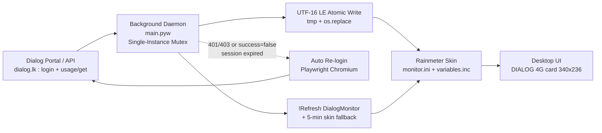

# Dialog 4G Rainmeter Data Monitor

> Live Dialog 4G data-balance widget for Windows desktops. A bulletproof Python background daemon syncs your Dialog usage to a clean Rainmeter skin — no WebParser, no RegEx, no flicker.

[](https://www.python.org/)
[](https://www.rainmeter.net/)
[](https://www.microsoft.com/windows)
[](LICENSE)

---

## Table of Contents

- [Preview](#preview--screenshots)
- [System Architecture](#system-architecture--flowchart)
- [Key Engineering Highlights](#key-engineering-highlights)
- [Prerequisites](#prerequisites)
- [Quick Start Setup](#quick-start-setup)
- [Project Structure](#project-structure)
- [How It Works](#how-it-works)
- [Troubleshooting \& FAQ](#troubleshooting--faq)
- [License](#license)

---

## Preview / Screenshots

> Place your screenshots under `docs/screenshots/` to enable these previews.


*Compact 340×236 card — title, up to 5 data packages, and 12-hour timestamp footer.*

```text
docs/screenshots/
├── dialog_widget.png      # Main widget (active packages view)
├── dialog_desktop.png     # Widget on desktop (optional, full context)
└── dialog_error.png       # Error / session-expired banner state (optional)
```

Additional placeholders you can wire up once captured:

```markdown


```

---

## System Architecture & Flowchart

No polling from Rainmeter. Python owns all I/O; Rainmeter is a dumb renderer fed by an atomically-written `variables.inc`.



**Data path in one line:**

`Dialog API → main.pyw (requests + Playwright) → data.json (UTF-8, debug) + variables.inc (UTF-16 LE, display) → !Refresh DialogMonitor → Desktop UI`

| Stage | Artifact | Encoding | Notes |
|---|---|---|---|
| Raw fetch | `data.json` | UTF-8 | Full package list + `updated_at` (`%I:%M:%S %p`) |
| Display feed | `variables.inc` | UTF-16 LE + BOM | `Status`, `UpdatedAt`, `Pkg1..Pkg5` (Name/Data/Total/Expires) |
| Skin | `monitor.ini` | UTF-16 LE | Shape `Rectangle 0,0,340,236,10`, footer `Updated: #UpdatedAt#` |
| Refresh | Rainmeter bang | — | `Rainmeter.exe !Refresh DialogMonitor` + 300s skin fallback |

---

## Key Engineering Highlights

- **Bulletproof background execution — Global mutex against duplicates.**
  `main.pyw` acquires `Global\DialogMonitorWidgetSingleInstance` via `CreateMutexW` *before* any third-party import. Double-clicks, editor F5, Startup + manual launch, or launcher twins all die in milliseconds with `[!] Another instance is already running.`

- **Atomic file writes — zero UI tearing.**
  Every write goes `*.tmp → os.replace(target)`. Readers (Rainmeter, JSON parsers) never observe a half-written `variables.inc` or `data.json`, even if the daemon is killed mid-flush.

- **UTF-16 LE encoding — Rainmeter-native compatibility.**
  `variables.inc` (and `monitor.ini`) are written/read as UTF-16 LE with BOM — Rainmeter's native encoding. No mojibake, no silent parse failures. Verified via `FF FE` BOM check.

- **12-hour AM/PM real-time status & timestamp.**
  All timestamps use `time.strftime("%I:%M:%S %p")` for both success and error paths. The skin renders it verbatim:
  `Updated: 10:48:11 PM`. Clear at a glance, no 24-hour mental math.

- **Security-first credential management via `.env` (gitignored).**
  Secrets (MSISDN, UUID, tokens) live in `.env`, never in git. Copy `.env.example → .env`, fill in your values, and `cookies.json` / `data.json` / `variables.inc` / `.env` all stay local per `.gitignore`.

Additional hardening baked in:

- Recursive package extractor (`usage_name` + `remaining_amount` at any JSON depth).
- `0 Bytes` / empty packages filtered out automatically.
- `sanitize_inc()` strips CR/LF and guards leading `;` (Rainmeter comment char).
- `BASE_DIR`-anchored paths — safe when CWD is `System32` under Startup/headless runs.
- Empty slots (`Pkg4`, `Pkg5`, …) auto-hide via `MeasurePkgNVis` + meter groups.

---

## Prerequisites

| Requirement | Version / Notes |
|---|---|
| Windows | 10 / 11 (64-bit) |
| Rainmeter | 4.x — [rainmeter.net](https://www.rainmeter.net/) |
| Python | 3.10+ (repo pinned to 3.12 — see `.python-version`) |
| Package manager | `uv` (recommended) or `pip` + `venv` |
| Browser driver | Playwright Chromium (`playwright install chromium`) — for auto re-login only |

> `main.pyw` uses `requests` + `playwright`. Install both (see below).

---

## Quick Start Setup

### 1. Clone the repository

```powershell
git clone <your-repo-url> dialog_monitor
cd dialog_monitor
```

### 2. Create and configure `.env`

```powershell
Copy-Item .env.example .env
notepad .env
```

Minimum `.env` (see `.env.example` for full annotated list):

```ini
# Dialog identity — keep secret, never commit
DIALOG_MSISDN=033XXXXXXX
DIALOG_UUID=YOUR_DIALOG_UUID
DIALOG_LANG=en

# Polling (seconds)
POLL_INTERVAL=300
```

> `.env`, `cookies.json`, `data.json`, and `variables.inc` are gitignored. If you fork this repo, only `.env.example` ships.

### 3. Install dependencies

Using `uv` (recommended — repo ships `pyproject.toml` + `uv.lock`):

```powershell
uv sync
uv run playwright install chromium
```

Or plain `pip`:

```powershell
py -3.12 -m venv .venv
.\.venv\Scripts\Activate.ps1
pip install requests playwright python-dotenv
playwright install chromium
```

### 4. Link the Rainmeter skin

The daemon writes directly to the skin folder and keeps a local backup copy:

- Live skin: `%USERPROFILE%\Documents\Rainmeter\Skins\DialogMonitor\`
  - `monitor.ini` (card layout, 340×236)
  - `variables.inc` (display feed, UTF-16 LE)
- Backup: `.\variables.inc` (repo root)

If you cloned fresh and the skin folder is empty, copy/symlink it:

```powershell
# Option A — copy (run from repo root)
Copy-Item .\skins\DialogMonitor\* `
  "$env:USERPROFILE\Documents\Rainmeter\Skins\DialogMonitor\" -Recurse -Force

# Option B — symlink (keeps repo + skin in sync, run from repo root)
New-Item -ItemType Directory -Force `
  "$env:USERPROFILE\Documents\Rainmeter\Skins\DialogMonitor"
New-Item -ItemType SymbolicLink `
  -Path "$env:USERPROFILE\Documents\Rainmeter\Skins\DialogMonitor\monitor.ini" `
  -Target .\skins\DialogMonitor\monitor.ini
```

Then load the skin in Rainmeter: tray icon → **Manage → DialogMonitor → monitor.ini → Load**, or run:

```powershell
& "C:\Program Files\Rainmeter\Rainmeter.exe" "!ActivateConfig" "DialogMonitor"
```

### 5. Run the daemon

```powershell
# Foreground (first run — completes Playwright login in a visible Chromium window)
uv run python main.pyw
# or
.\.venv\Scripts\pythonw.exe main.pyw
```

First run opens `https://dialog.lk/mydialog-web/login`. Log in once — cookies persist to `cookies.json` for subsequent headless polls every 5 minutes.

Manual refresh at any time:

```powershell
& "C:\Program Files\Rainmeter\Rainmeter.exe" "!Refresh" "DialogMonitor"
```

### 6. Autostart on Windows boot (`shell:startup`)

1. Press `Win + R`, type `shell:startup`, press Enter.
2. Create a shortcut with:
   - **Target:** `.\.venv\Scripts\pythonw.exe .\main.pyw`
   - **Start in:** repo folder (e.g. `dialog_monitor`)
3. Double-click the shortcut once to verify — a second copy exits instantly via the mutex.

> A pre-made `DialogMonitor.lnk` is gitignored locally (per-machine). Recreate it via the steps above on each PC.

---

## Project Structure

```text
D:\Projects\dialog_monitor\
├── main.pyw                  # Background daemon (mutex → fetch → atomic write → !Refresh)
├── pyproject.toml            # Deps: requests (+ playwright, python-dotenv)
├── uv.lock                   # Locked dependency tree
├── .python-version           # 3.12
├── .env.example              # Template secrets (commit this, never .env)
├── .env                      # Your secrets (gitignored)
├── variables.inc             # Local backup display feed (UTF-16 LE, gitignored)
├── data.json                 # Raw fetch dump (UTF-8, gitignored)
├── cookies.json              # Persisted session (gitignored)
├── DialogMonitor.lnk         # Startup shortcut (gitignored, per-machine)
└── docs/
    └── screenshots/
        ├── dialog_widget.png
        ├── dialog_desktop.png
        └── dialog_error.png
```

Skin (outside repo, written by daemon):

```text
%USERPROFILE%\Documents\Rainmeter\Skins\DialogMonitor\
├── monitor.ini               # Card 340×236, radius 10, footer Y=208, UTF-16 LE
└── variables.inc             # Live feed: Status / UpdatedAt / Pkg1..Pkg5
```

`variables.inc` shape (example):

```ini
[Variables]
Status=success
UpdatedAt=10:48:11 PM
PkgCount=3
Pkg1Name=HBB Rewards
Pkg1Data=23.70 GB
Pkg1Total=
Pkg1Expires=12 d : 1 hrs more
...
```

---

## How It Works

1. **Single-instance guard** — `CreateMutexW(Global\DialogMonitorWidgetSingleInstance)`; duplicates `os._exit(0)`.
2. **Load session** — `cookies.json` if present, else Playwright login to `dialog.lk`.
3. **Fetch** — `POST https://dialog.lk/selfcare-proxy?r=usage/get` with MSISDN/UUID/lang headers.
4. **Expiry check** — `None` / `401` / `403` / `code in (401,404)` / `success is False` → fresh Playwright login → retry once.
5. **Extract** — recursive scan for `usage_name` + `remaining_amount`; drop `0 Bytes`/empty.
6. **Persist atomically** — `data.json` (UTF-8) + `variables.inc` (UTF-16 LE) via `tmp + os.replace`; timestamp `%I:%M:%S %p`.
7. **Refresh UI** — `Rainmeter.exe !Refresh DialogMonitor`; skin fallback `MeasureAutoRefresh` every 300 ticks.
8. **Render** — `monitor.ini` shows `DIALOG 4G`, package rows (empty groups hidden), footer `Updated: #UpdatedAt#`, error banner on `Status=error`.
9. **Sleep 300s** — repeat.

---

## Troubleshooting & FAQ

### Widget shows "Update failed - retrying..."

`Status=error` was written. Check the daemon console:

- `Fetch failed with status: 401/403` → session expired; daemon should auto-open Playwright and re-login. Complete the login window — do not close it early (it waits up to 120s + `networkidle`).
- `No Response` → network/DNS down or Dialog portal maintenance. Retries automatically in 5 min.
- Stuck in loop? Delete `cookies.json` to force a clean login on next cycle:
  ```powershell
  Remove-Item .\cookies.json -Force
  ```

### Session expiry / token refresh — how does it work?

| Signal | Meaning | Action |
|---|---|---|
| HTTP `401` / `403` | Cookie rejected | Auto re-login |
| JSON `code: 401/404` or `success: false` | Token expired server-side | Auto re-login |
| `requests` exception / timeout (15s) | Network blip | Write `error` state, retry in 300s |

Re-login launches **visible** Chromium (`headless=False`) so SSO/OTP works. After `mydialog-web/**` + `networkidle` + 3s settle, cookies are saved and the fetch retried immediately.

### Verifying the mutex / killing duplicate background instances

Only **one** `main.pyw` / `pythonw.exe` should run. Check:

```powershell
# Who is running?
Get-CimInstance Win32_Process -Filter "Name='pythonw.exe' OR Name='python.exe'" |
  Where-Object { $_.CommandLine -like '*dialog_monitor*' } |
  Select-Object ProcessId, CommandLine

# Or simply:
tasklist /FI "IMAGENAME eq pythonw.exe" /V
tasklist /FI "IMAGENAME eq python.exe" /V
```

Kill duplicates (mutex normally prevents these, but useful after crashes or when switching venvs):

```powershell
# Targeted — kill only dialog_monitor processes
Get-CimInstance Win32_Process -Filter "Name='pythonw.exe' OR Name='python.exe'" |
  Where-Object { $_.CommandLine -like '*dialog_monitor*' } |
  ForEach-Object { Stop-Process -Id $_.ProcessId -Force }

# Nuclear option — all pythonw (careful: kills other Python apps too)
taskkill /F /IM pythonw.exe
```

If a zombie mutex survives a crash, it is a kernel `Global\` mutex tied to the owning process — killing the owner releases it. No reboot needed; just kill the stale PID and relaunch.

### Skin shows stale time / blank rows

1. Confirm `variables.inc` is fresh:
   ```powershell
   Get-Content "$env:USERPROFILE\Documents\Rainmeter\Skins\DialogMonitor\variables.inc" -Encoding Unicode | Select-Object -First 5
   ```
   Expect `UpdatedAt=10:48:11 PM` (12-hour + AM/PM).
2. Force refresh:
   ```powershell
   & "C:\Program Files\Rainmeter\Rainmeter.exe" "!Refresh" "DialogMonitor"
   ```
3. Check encoding — must be UTF-16 LE with BOM:
   ```powershell
   python -c "with open(r'$env:USERPROFILE\Documents\Rainmeter\Skins\DialogMonitor\variables.inc','rb') as f: print(list(f.read(2)))"
   # Expect [255, 254]
   ```
4. Blank rows are **by design** — empty `PkgNName` groups auto-hide. `PkgCount` tells you how many are live.

### Playwright / Chromium issues

```powershell
# Reinstall driver after Python upgrade
uv run playwright install chromium --with-deps
# Or: playwright install --help  (if PATH differs)
```

If the login window never appears, run with `python` (not `pythonw`) once to see console output.

---

## License

MIT — do what you want, no warranty. Dialog portal/API belongs to Dialog Axiata; this is an unofficial personal-use monitor.
