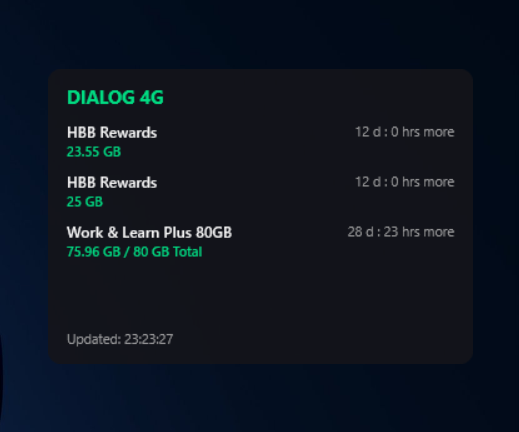
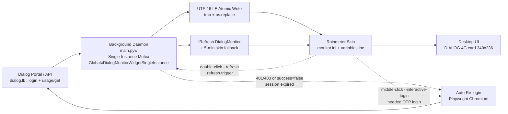

# Dialog 4G Rainmeter Data Monitor

> Live Dialog 4G data-balance widget for Windows desktops. A bulletproof Python background daemon syncs your Dialog usage to a clean Rainmeter skin — no WebParser, no RegEx, no flicker.

[](https://www.python.org/)
[](https://www.rainmeter.net/)
[](https://www.microsoft.com/windows)
[](LICENSE)

---

## Table of Contents

- [Preview / Screenshots](#preview--screenshots)
- [System Architecture \& Flowchart](#system-architecture--flowchart)
- [Operating Model \& Daemon Lifecycle](#operating-model--daemon-lifecycle)
- [Fast-Path Manual Refresh \& IPC Signaling](#fast-path-manual-refresh--ipc-signaling)
- [Authentication \& Session Recovery](#authentication--session-recovery)
- [Data Bridge \& UI Synchronization](#data-bridge--ui-synchronization)
- [Key Engineering Highlights](#key-engineering-highlights)
- [Prerequisites](#prerequisites)
- [Quick Start Setup](#quick-start-setup)
- [Windows Startup Configuration](#windows-startup-configuration)
- [CLI Arguments](#cli-arguments)
- [Project Structure](#project-structure)
- [How It Works](#how-it-works)
- [Troubleshooting \& FAQ](#troubleshooting--faq)
- [Security Practices](#security-practices)
- [License](#license)

---

## Preview / Screenshots




*Compact 340×236 card — title, up to 5 data packages, and 12-hour timestamp footer.*

```text
docs/screenshots/
├── dialog_widget.png      # Main widget (active packages view)
├── dialog_desktop.png     # Widget on desktop (optional, full context)
└── dialog_error.png       # Error / session-expired banner state (optional)
```


---

## System Architecture & Flowchart

No polling from Rainmeter. Python owns all I/O; Rainmeter is a dumb renderer fed by an atomically-written `variables.inc`.



```text
                 +--------------------------------+
                 | Dialog Portal / API            |
                 | login + POST usage/get         |
                 +---------------+----------------+
                                 | POST (cookies + MSISDN/UUID/lang)
                                 v
                 +--------------------------------+
                 | main.pyw (pythonw.exe)         |
                 | - Mutex owner                  |
                 | - 15-min poll + 1s trig poll   |
                 | - Headed re-login on 401/403   |
                 +---------------+----------------+
                                 | tmp + os.replace (UTF-16 LE BOM)
                                 v
                 +--------------------------------+
                 | variables.inc (x2)             |
                 | skin live + repo backup        |
                 +---------------+----------------+
                                 | !Refresh DialogMonitor
                                 v
                 +--------------------------------+
                 | monitor.ini -> DIALOG 4G card  |
                 +--------------------------------+
```

**Data path in one line:**

`Dialog API → main.pyw (requests + Playwright) → data.json (UTF-8, debug) + variables.inc (UTF-16 LE, display) → !Refresh DialogMonitor → Desktop UI`

| Stage | Artifact | Encoding | Notes |
|---|---|---|---|
| Raw fetch | `data.json` | UTF-8 | Full package list + `updated_at` (`%I:%M:%S %p`) |
| Display feed | `variables.inc` | UTF-16 LE + BOM | `Status`, `UpdatedAt`, `Pkg1..Pkg5` (Name/Data/Total/Expires) |
| Skin | `monitor.ini` | UTF-16 LE | Shape `Rectangle 0,0,340,236,10`, footer `Updated: #UpdatedAt#` |
| Refresh | Rainmeter bang | — | `Rainmeter.exe !Refresh DialogMonitor` + 300s skin fallback |

---

## Operating Model & Daemon Lifecycle

- **Windowless background daemon** — production runs under `pythonw.exe` (no console window). All paths are `BASE_DIR`-anchored to the script folder, so `shell:startup` / headless launches work even when CWD is `System32`.
- **OS-level single-instance mutex** — `main.pyw` acquires `Global\DialogMonitorWidgetSingleInstance` via `CreateMutexW` **before any third-party import** and holds the handle for the process lifetime. This strictly prevents duplicate background instances, racing writers, and file-write collisions. Plain duplicate launches (double-clicks, editor F5, Startup + manual launch) die in milliseconds.
- **Periodic polling: 15 minutes (900 s)** — `POLL_INTERVAL` defaults to `900` (configurable via `.env`) to conserve resources and avoid provider rate-limiting. Each cycle loads `cookies.json` / `.env`, issues one `POST https://dialog.lk/selfcare-proxy?r=usage/get` with `MSISDN` / `UUID` / `lang` headers, extracts packages, and rewrites the display feed.
- **1-second trigger polling** — between periodic fetches the daemon loop sleeps in `min(TRIGGER_POLL_SECONDS, remaining)` slices (`TRIGGER_POLL_SECONDS = 1.0`), consuming `.refresh.trigger` every second for instant manual refreshes without shortening the 15-minute API cadence.
- **Fail-safe auto-promotion** — if no daemon is running when a manual action is invoked:
  - `--refresh`: the process finds the mutex free, holds it, performs an **initial sync/fetch now** for instant UI feedback, then **promotes itself into `run_daemon_loop()`** (1s trigger polling + 15-minute periodic syncs) instead of terminating.
  - `--interactive-login` with no daemon: headed login + immediate sync, then likewise **continues as the background daemon** so the widget keeps refreshing.
  - `--interactive-login` with a live daemon: runs as a short-lived **one-shot alongside** the daemon (headed login → fetch → atomic write → `!Refresh` → exit with status code), so forced re-login never kills the background loop.

> Result: the system is never left without a running daemon after a user-initiated refresh, even if the daemon had previously died.

---

## Fast-Path Manual Refresh & IPC Signaling

The skin wires two gestures (see `monitor.ini`):

```ini
ToolTipText=Double-click to refresh now | Middle-click for interactive login
LeftMouseDoubleClickAction=["<repo>\.venv\Scripts\pythonw.exe" "<repo>\main.pyw" --refresh]
MiddleMouseUpAction=["<repo>\.venv\Scripts\pythonw.exe" "<repo>\main.pyw" --interactive-login]
```

**Dual-mode `--refresh` (lightweight manual sync):**

| Path | Condition | Behavior |
|---|---|---|
| **Active daemon** | Mutex already held | Secondary process touches lightweight `.refresh.trigger` (timestamp payload) and exits in **~0.1s before importing `requests`/Playwright**. The running daemon intercepts it on its 1s poll, deletes the file (each click = 1 poll, with a 50 ms retry on Windows file-lock races), runs an immediate API poll, resets the periodic timer, and refreshes the skin. |
| **Inactive daemon** | Mutex free | Process holds the mutex, does a **direct initial fetch + `variables.inc` write** for instant UI feedback, then **auto-promotes into the daemon loop** instead of terminating. |

**`--interactive-login` (headed manual sync):**

- Always runs the full headed login + immediate fetch + `!Refresh`, whether or not a daemon is alive.
- Daemon alive → one-shot alongside it (atomic `tmp + os.replace` writes keep the brief overlap tear-free), exits `0`/`1`.
- No daemon → stays alive as the daemon afterwards (`run_daemon_loop(initial_fetch_done=ok)`).

Additional hardening:

- Stale triggers are dropped on daemon startup so boot does not double-poll (the first cycle already fetches).
- A trigger that lands mid-fetch is consumed immediately after the cycle and refetches at once.
- The `--refresh` fast path runs **before** third-party imports, keeping double-click latency at millisecond scale.

---

## Authentication & Session Recovery

- **On-demand interactive authentication (`--interactive-login`)** — opens a **visible Chromium** (`headless=False`, 180 s timeout) at `https://dialog.lk/mydialog-web/login` so browser OTP / credential verification works. The user completes login + OTP; the daemon waits for `**/mydialog-web/**` + `networkidle` + 3 s settle, then:
  1. Builds the cookie header from `context.cookies()`.
  2. Best-effort scans cookie names + `localStorage` / `sessionStorage` for token-like keys (`token` / `bearer` / `jwt` / `auth` / `access` / `id_token`, capped at 8k chars).
  3. Atomically persists the session to **`cookies.json`** (`{"cookie": "…", "bearer_tokens": {…}}`, UTF-8 `tmp + os.replace`) **and `.env`** (upserts `DIALOG_COOKIE` / `DIALOG_BEARER_TOKEN`, preserving all other keys/comments).
  4. Fetches usage immediately with the just-captured session (`cookie_override`, no redundant disk read) and bangs `!Refresh`.
- **Automatic re-login on expiry** — each cycle treats `None` / `401` / `403` / JSON `code in (401, 404)` / `success is False` / JSON parse failure as session expiry, launches the same headed login automatically (120 s timeout), saves the fresh session, and retries once. A captured `DIALOG_BEARER_TOKEN` is also sent as `Authorization: Bearer …` (harmless when the backend only checks cookies).
- **Identity via `.env` (hot-loaded at startup)** — `DIALOG_MSISDN`, `DIALOG_UUID`, `DIALOG_LANG`, `POLL_INTERVAL`. Falls back to legacy defaults so existing installs keep working.
- **Clean error states** — fetch failures write `Status=error` + fresh `UpdatedAt` (instead of stale blanks); the skin shows `Update failed - retrying...` and empty `PkgN` slots auto-hide via `MeasurePkgNVis` + meter groups. Next cycle (≤15 min, or instant via double-click) retries automatically.
- **No lingering browsers** — the `with sync_playwright()` block + `finally: browser.close()` guarantees no Chromium/Playwright children survive user-close or timeout.

---

## Data Bridge & UI Synchronization

- **Atomic writes (`tmp` + `os.replace`)** — every `variables.inc`, `data.json`, `cookies.json`, and `.env` update goes through a temp file plus atomic replace, so Rainmeter / JSON readers never observe a torn half-written file, even if the daemon is killed mid-flush.
- **Native UTF-16 LE BOM encoding** — `variables.inc` is written with `encoding="utf-16"` (BOM `FF FE`, Rainmeter's native encoding) to both the live skin (`%USERPROFILE%\Documents\Rainmeter\Skins\DialogMonitor\variables.inc`) and the repo-local backup (`.\variables.inc`). Verified via BOM check. `sanitize_inc()` additionally strips CR/LF and guards leading `;` (Rainmeter comment char).
- **Automated Rainmeter bangs for real-time refresh** — after each write the daemon runs `Rainmeter.exe !Refresh DialogMonitor` (5 s timeout, failures swallowed). The skin also self-refreshes every 300 s via `MeasureAutoRefresh` as a fallback.
- **12-hour AM/PM timestamps** — all paths use `time.strftime("%I:%M:%S %p")` (e.g. `Updated: 07:17:04 PM`), rendered verbatim in the card footer.
- **Recursive package extractor** — scans any JSON depth for `usage_name` + `remaining_amount`, drops `0 Bytes` / empty packages, and pre-formats `PkgNData` (`"65.14 GB / 80 GB Total"` or just `"19.06 GB"` when total is empty/`N/A`).

---

## Key Engineering Highlights

- **Bulletproof background execution — Global mutex against duplicates.**
  `main.pyw` acquires `Global\DialogMonitorWidgetSingleInstance` via `CreateMutexW` *before* any third-party import. Plain duplicates die in milliseconds; `--refresh` signals via trigger file; `--interactive-login` one-shots alongside by design.
- **Fail-safe auto-promotion — never left daemonless.**
  `--refresh` (or `--interactive-login`) with no daemon running fetches immediately for instant UI feedback, then stays alive as the daemon (1s trigger poll + 15-min periodic fetch).
- **Instant manual refresh — trigger-file IPC.**
  `.refresh.trigger` + 1s daemon polling gives ~1s double-click-to-UI latency; each trigger file is consumed exactly once.
- **Atomic file writes — zero UI tearing.**
  Every write goes `*.tmp → os.replace(target)`. Readers never observe half-written `variables.inc`, `data.json`, `cookies.json`, or `.env`.
- **UTF-16 LE encoding — Rainmeter-native compatibility.**
  `variables.inc` (and `monitor.ini`) are UTF-16 LE with BOM. No mojibake, no silent parse failures. Verified via `FF FE` BOM check.
- **12-hour AM/PM real-time status & timestamp.**
  All timestamps use `time.strftime("%I:%M:%S %p")` for both success and error paths.
- **Security-first credential management via `.env` + `cookies.json` (gitignored).**
  Secrets (MSISDN, UUID, cookies, bearer tokens) live locally only; headed first-party login means the daemon never handles raw passwords/OTPs.

Additional hardening baked in:

- Recursive package extractor (`usage_name` + `remaining_amount` at any JSON depth).
- `0 Bytes` / empty packages filtered out automatically.
- `sanitize_inc()` strips CR/LF and guards leading `;` (Rainmeter comment char).
- `BASE_DIR`-anchored paths — safe when CWD is `System32` under Startup/headless runs.
- Empty slots (`Pkg4`, `Pkg5`, …) auto-hide via `MeasurePkgNVis` + meter groups.
- `MAX_SLOTS = 5` display slots; `PkgCount` tells the skin how many are live.

---

## Prerequisites

| Requirement | Version / Notes |
|---|---|
| Windows | 10 / 11 (64-bit) |
| Rainmeter | 4.x — [rainmeter.net](https://www.rainmeter.net/) |
| Python | 3.12+ (repo pinned to 3.12 — see `.python-version`) |
| Package manager | `uv` (recommended — ships `pyproject.toml` + `uv.lock`) or `pip` + `venv` |
| `requests >= 2.34.2` | API polling (declared in `pyproject.toml`) |
| `playwright` + Chromium | Required at runtime for headed login / auto re-login (`playwright install chromium`; note: not pinned in `pyproject.toml`, install explicitly) |
| `python-dotenv` | Optional — **not required**; `main.pyw` ships a minimal zero-dependency `.env` loader |
| Browser driver | Playwright Chromium (`playwright install chromium`) — for interactive login + auto re-login only |

> `main.pyw` uses `requests` + `playwright` (stdlib `.env` loader). Install both (see below).

---

## Quick Start Setup

### 1. Clone the repository

```powershell
git clone <your-repo-url> dialog_monitor
cd dialog_monitor
```

### 2. Create and configure `.env`

This repo ships **no `.env.example`** — create `.env` directly (gitignored). Minimum content:

```powershell
notepad .env
```

```ini
# Dialog identity — keep secret, never commit
DIALOG_MSISDN=033XXXXXXX
DIALOG_UUID=YOUR_DIALOG_UUID
DIALOG_LANG=en

# Polling (seconds, default 900 = 15 min)
POLL_INTERVAL=900
```

> `.env`, `cookies.json`, `data.json`, and `variables.inc` are gitignored. Session cookies/tokens are filled in automatically by `--interactive-login` (below); identity values can be edited by hand at any time.

### 3. Install dependencies

Using `uv` (recommended — repo ships `pyproject.toml` + `uv.lock`):

```powershell
uv sync
uv run playwright install chromium
```

Or plain `pip`:

```powershell
py -3.12 -m venv .venv
.\.venv\Scripts\Activate.ps1
pip install requests playwright python-dotenv
playwright install chromium
```

> `python-dotenv` is optional (the daemon parses `.env` itself); `playwright` is mandatory for login flows even though only `requests` is pinned in `pyproject.toml`.

### 4. Link the Rainmeter skin

The daemon writes directly to the skin folder and keeps a local backup copy:

- Live skin: `%USERPROFILE%\Documents\Rainmeter\Skins\DialogMonitor\`
  - `monitor.ini` (card layout, 340×236)
  - `variables.inc` (display feed, UTF-16 LE)
- Backup: `.\variables.inc` (repo root)

The repo ships no `skins/` source folder — on an existing install the live skin folder already contains `monitor.ini` (the daemon only generates `variables.inc`), so skip this step. If you cloned fresh onto a new machine and the skin folder is empty, restore it from backup; when a source copy exists, copy/symlink it:

```powershell
# Option A — copy (run from repo root)
Copy-Item .\skins\DialogMonitor\* `
  "$env:USERPROFILE\Documents\Rainmeter\Skins\DialogMonitor\" -Recurse -Force

# Option B — symlink (keeps repo + skin in sync, run from repo root)
New-Item -ItemType Directory -Force `
  "$env:USERPROFILE\Documents\Rainmeter\Skins\DialogMonitor"
New-Item -ItemType SymbolicLink `
  -Path "$env:USERPROFILE\Documents\Rainmeter\Skins\DialogMonitor\monitor.ini" `
  -Target .\skins\DialogMonitor\monitor.ini
```

Then load the skin in Rainmeter: tray icon → **Manage → DialogMonitor → monitor.ini → Load**, or run:

```powershell
& "C:\Program Files\Rainmeter\Rainmeter.exe" "!ActivateConfig" "DialogMonitor"
```

### 5. First login + start the daemon

```powershell
# On-demand headed login (visible Chromium — complete OTP/credentials once)
.\.venv\Scripts\python.exe main.pyw --interactive-login
```

This captures the session to `cookies.json` + `.env`, fetches usage immediately, refreshes the widget — and if no daemon was running, **stays alive as the background daemon** afterwards.

For silent production runs (no console), use `pythonw.exe`:

```powershell
$root = $PWD.Path
Start-Process -FilePath "$root\.venv\Scripts\pythonw.exe" -ArgumentList "`"$root\main.pyw`"" -WorkingDirectory "$root"
```

First daemon cycle fetches immediately, then every 15 minutes (plus 1s trigger polling for instant refreshes). To watch logs once, run with `python.exe` (not `pythonw.exe`).

Manual refresh at any time (double-click the widget, or):

```powershell
.\.venv\Scripts\pythonw.exe main.pyw --refresh
& "C:\Program Files\Rainmeter\Rainmeter.exe" "!Refresh" "DialogMonitor"
```

---

## Windows Startup Configuration

Run automatically on Windows logon via `shell:startup`:

1. Press `Win + R`, type `shell:startup`, press Enter.
2. Create a shortcut with (use absolute paths, e.g. `D:\Projects\dialog_monitor`):
   - **Target:** `<repo>\.venv\Scripts\pythonw.exe "<repo>\main.pyw"`
   - **Start in:** `<repo>` (e.g. `D:\Projects\dialog_monitor`)
3. Double-click the shortcut once to verify — a plain second copy exits instantly via the mutex, while `--refresh` signals the daemon.

> A pre-made `DialogMonitor.lnk` is gitignored locally (per-machine). Recreate it via the steps above on each PC. `BASE_DIR`-anchored paths keep Startup launches (CWD = `System32`) working.

```powershell
# Example — launch daemon now (silent, windowless)
$root = "D:\Projects\dialog_monitor"
Start-Process -FilePath "$root\.venv\Scripts\pythonw.exe" -ArgumentList "`"$root\main.pyw`"" -WorkingDirectory "$root"
```

---

## CLI Arguments

| Flag | Mode | Behavior |
|---|---|---|
| *(none)* | Daemon | Acquire `Global\DialogMonitorWidgetSingleInstance` (or exit if held), clear stale `.refresh.trigger`, immediate fetch, then loop: 1s trigger poll + `POLL_INTERVAL` (default 900s) periodic fetch. |
| `--refresh` | Lightweight manual sync | Daemon running → touch `.refresh.trigger`, exit ~0.1s (before heavy imports). No daemon → initial fetch + **auto-promote to daemon**. Bound to widget double-click. |
| `--interactive-login` | Headed manual sync | Visible Chromium login (OTP supported) → capture cookies/bearer tokens → atomic save to `cookies.json` + `.env` → immediate fetch → `!Refresh`. Daemon running → one-shot alongside (exit `0`/`1`). No daemon → **continue as daemon**. Bound to widget middle-click. |
| `--help`, `-h` | Help | Print usage (`daemon` / `--refresh` / `--interactive-login`) and exit `0`. Never blocked by the mutex. |

```powershell
# Background daemon (normal production)
.\.venv\Scripts\pythonw.exe main.pyw

# Lightweight refresh (fast path when daemon alive, auto-promote when not)
.\.venv\Scripts\pythonw.exe main.pyw --refresh

# Forced headed re-login + immediate sync
.\.venv\Scripts\python.exe main.pyw --interactive-login

# Help
.\.venv\Scripts\python.exe main.pyw --help
```

> `--refresh` is matched as an exact `sys.argv` token; `--interactive-login` takes precedence when both are passed (headed re-login wins over the lightweight signal). Use `python.exe` (not `pythonw.exe`) when you want to see login/console output.

---

## Project Structure

```text
D:\Projects\dialog_monitor\
├── main.pyw                  # Background daemon (mutex → fetch → atomic write → !Refresh)
├── pyproject.toml            # Deps: requests (+ playwright, python-dotenv)
├── uv.lock                   # Locked dependency tree
├── .python-version           # 3.12
├── .env                      # Your secrets (gitignored; DIALOG_MSISDN/UUID/LANG/POLL_INTERVAL + captured tokens)
├── variables.inc             # Local backup display feed (UTF-16 LE, gitignored)
├── data.json                 # Raw fetch dump (UTF-8, gitignored)
├── cookies.json              # Persisted session (gitignored)
├── .refresh.trigger          # Manual-refresh IPC signal (transient, gitignored)
├── DialogMonitor.lnk         # Startup shortcut (gitignored, per-machine)
└── docs/
    └── screenshots/
        ├── dialog_widget.png
        ├── dialog_desktop.png
        └── dialog_error.png
```

Skin (outside repo, written by daemon):

```text
%USERPROFILE%\Documents\Rainmeter\Skins\DialogMonitor\
├── monitor.ini               # Card 340×236, radius 10, footer Y=208, UTF-16 LE
└── variables.inc             # Live feed: Status / UpdatedAt / Pkg1..Pkg5
```

`variables.inc` shape (example):

```ini
[Variables]
Status=success
UpdatedAt=10:48:11 PM
PkgCount=3
Pkg1Name=HBB Rewards
Pkg1Data=23.70 GB
Pkg1Total=
Pkg1Expires=12 d : 1 hrs more
...
```

Gitignored local state (never commit): `.env`, `cookies.json`, `data.json`, `variables.inc`, `.refresh.trigger`, `DialogMonitor.lnk`, `__pycache__/`, `.venv/`, `*.tmp`.

---

## How It Works

1. **Single-instance guard** — `CreateMutexW(Global\DialogMonitorWidgetSingleInstance)` before heavy imports; plain duplicates `os._exit(0)`. `--refresh` signals + fast-exits when a daemon lives, auto-promotes when none does. `--interactive-login` one-shots alongside by design.
2. **Load session** — `cookies.json` if present (else headed Playwright login to `dialog.lk`), plus `.env` identity (`DIALOG_MSISDN` / `UUID` / `LANG`) and optional `DIALOG_BEARER_TOKEN`.
3. **Fetch** — `POST https://dialog.lk/selfcare-proxy?r=usage/get` with MSISDN/UUID/lang headers (+ `Authorization: Bearer …` when a token was captured), 15 s timeout.
4. **Expiry check** — `None` / `401` / `403` / `code in (401,404)` / `success is False` / JSON parse failure → fresh headed login → retry once.
5. **Extract** — recursive scan for `usage_name` + `remaining_amount`; drop `0 Bytes`/empty; cap at `MAX_SLOTS = 5`.
6. **Persist atomically** — `data.json` (UTF-8) + `variables.inc` (UTF-16 LE) + on login `cookies.json` / `.env` via `tmp + os.replace`; timestamp `%I:%M:%S %p`.
7. **Refresh UI** — `Rainmeter.exe !Refresh DialogMonitor`; skin fallback `MeasureAutoRefresh` every 300 s.
8. **Render** — `monitor.ini` shows `DIALOG 4G`, package rows (empty groups hidden), footer `Updated: #UpdatedAt#`, error banner on `Status=error`.
9. **Loop** — 1 s trigger poll for manual refreshes; periodic fetch every `POLL_INTERVAL` (default 900 s); repeat.

---

## Troubleshooting & FAQ

### Manual refresh feels slow / does nothing

- Double-click = `main.pyw --refresh`. Daemon running → `.refresh.trigger` appears briefly, daemon logs `Manual refresh trigger consumed — fetching now`, widget updates in ~1s.
- No daemon → the `--refresh` process itself logs `auto-promoting to daemon` and stays alive. Verify with `Get-Process pythonw` (below).
- If the widget never updates, force the bang directly:

  ```powershell
  & "C:\Program Files\Rainmeter\Rainmeter.exe" "!Refresh" "DialogMonitor"
  ```

### Widget shows "Update failed - retrying..."

`Status=error` was written. Check the daemon console (run once with `python.exe` to see logs):

- `Fetch failed with status: 401/403` → session expired; daemon should auto-open headed Chromium and re-login. Complete the login window — do not close it early (auto path waits up to 120s + `networkidle`).
- `code: 401/404` or `success: false` → token expired server-side; same auto re-login path.
- `No Response` → network/DNS down or Dialog portal maintenance. Retries automatically in ≤15 min (or double-click for instant retry).
- Stuck in loop? Delete `cookies.json` to force a clean login on next cycle:

  ```powershell
  Remove-Item .\cookies.json -Force
  .\.venv\Scripts\python.exe main.pyw --interactive-login
  ```

### Session expiry / token refresh — how does it work?

| Signal | Meaning | Action |
|---|---|---|
| HTTP `401` / `403` | Cookie rejected | Auto re-login (headed, 120s) |
| JSON `code: 401/404` or `success: false` | Token expired server-side | Auto re-login (headed, 120s) |
| `requests` exception / timeout (15s) | Network blip | Write `error` state, retry in ≤15 min |
| `--interactive-login` (manual) | User forces refresh | Headed login (180s, OTP visible) + immediate sync |

Re-login launches **visible** Chromium (`headless=False`) so SSO/OTP works. After `mydialog-web/**` + `networkidle` + 3s settle, cookies + bearer tokens are saved (`cookies.json` + `.env`) and the fetch retried immediately.

### Verifying the mutex / killing duplicate background instances

Only **one** daemon `main.pyw` / `pythonw.exe` should own the loop (`--interactive-login` one-shots are the intentional exception). Check:

```powershell
# Who is running?
Get-CimInstance Win32_Process -Filter "Name='pythonw.exe' OR Name='python.exe'" |
  Where-Object { $_.CommandLine -like '*dialog_monitor*' } |
  Select-Object ProcessId, CommandLine

# Or simply:
tasklist /FI "IMAGENAME eq pythonw.exe" /V
tasklist /FI "IMAGENAME eq python.exe" /V
```

Kill duplicates (mutex normally prevents these, but useful after crashes or when switching venvs):

```powershell
# Targeted — kill only dialog_monitor processes
Get-CimInstance Win32_Process -Filter "Name='pythonw.exe' OR Name='python.exe'" |
  Where-Object { $_.CommandLine -like '*dialog_monitor*' } |
  ForEach-Object { Stop-Process -Id $_.ProcessId -Force }

# Nuclear option — all pythonw (careful: kills other Python apps too)
taskkill /F /IM pythonw.exe
```

If a zombie mutex survives a crash, it is a kernel `Global\` mutex tied to the owning process — killing the owner releases it. No reboot needed; just kill the stale PID and relaunch.

### Skin shows stale time / blank rows

1. Confirm `variables.inc` is fresh:
   ```powershell
   Get-Content "$env:USERPROFILE\Documents\Rainmeter\Skins\DialogMonitor\variables.inc" -Encoding Unicode | Select-Object -First 5
   ```
   Expect `UpdatedAt=10:48:11 PM` (12-hour + AM/PM).
2. Force refresh:
   ```powershell
   & "C:\Program Files\Rainmeter\Rainmeter.exe" "!Refresh" "DialogMonitor"
   ```
3. Check encoding — must be UTF-16 LE with BOM:
   ```powershell
   python -c "with open(r'$env:USERPROFILE\Documents\Rainmeter\Skins\DialogMonitor\variables.inc','rb') as f: print(list(f.read(2)))"
   # Expect [255, 254]
   ```
4. Blank rows are **by design** — empty `PkgNName` groups auto-hide. `PkgCount` tells you how many are live.

### Playwright / Chromium issues

```powershell
# Reinstall driver after Python upgrade
uv run playwright install chromium --with-deps
# Or: playwright install --help  (if PATH differs)
```

If the login window never appears, run with `python` (not `pythonw`) once to see console output. Headed mode requires an interactive desktop session — RDP-minimized / headless hosts may need a foreground run.

---

## Security Practices

- Secrets live only in gitignored local state — `.env` (`DIALOG_MSISDN`, `DIALOG_UUID`, `DIALOG_COOKIE`, `DIALOG_BEARER_TOKEN`) and `cookies.json`. Never in git, never in the skin.
- No `.env.example` ships (per-machine credentials); if you fork, document required keys without pasting real values.
- Headed first-party login means the user types credentials/OTP directly on `dialog.lk` — the daemon only captures the resulting session cookies/tokens, never keystrokes or passwords.
- Bearer tokens are capped (8k chars) before persistence and sent only to `dialog.lk`; no token is ever logged.
- `data.json` / `variables.inc` contain only usage aggregates (no credentials) but remain gitignored as local state.
- `*.tmp` swap files are gitignored so interrupted atomic writes never get committed.

---

## License

MIT — do what you want, no warranty. Dialog portal/API belongs to Dialog Axiata; this is an unofficial personal-use monitor.
